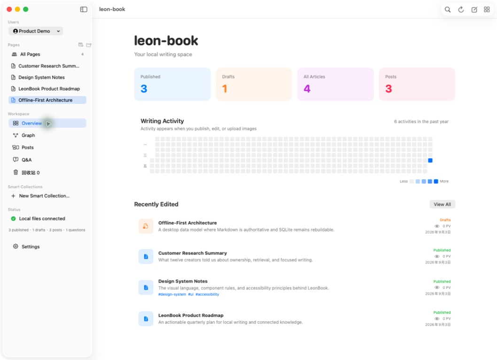
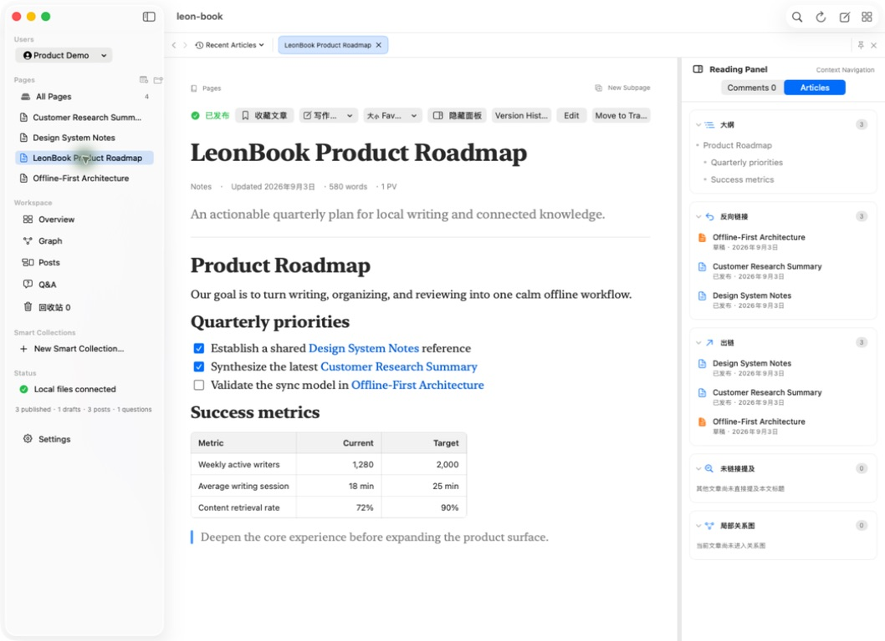
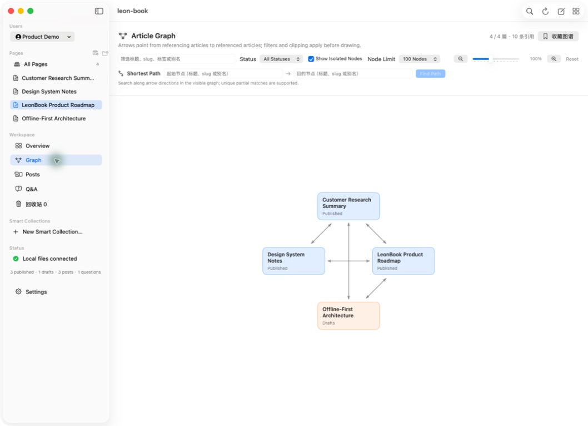
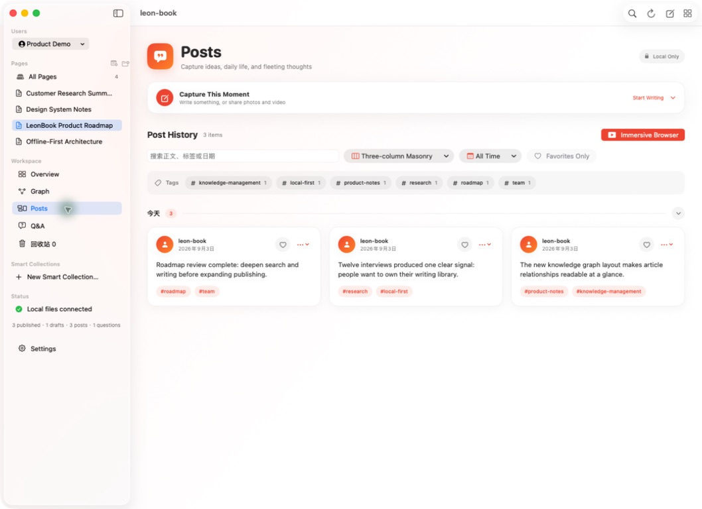
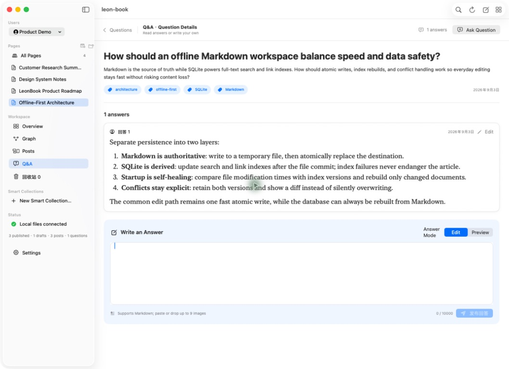

# leon-book

[English](README.md) | [简体中文](README.zh-CN.md)

A native macOS workspace for writing, collecting ideas, and organizing personal content. Keep articles, local posts, Q&A, tasks, photos, audio, video, whiteboards, and chat together, with a customizable homepage built around your workflow.

Built with **SwiftUI, AppKit, WebKit, and SQLite**. Core writing and library features run fully offline with no Node.js service, external browser, or local HTTP server required. All articles, structured records, and media stay in your chosen local data directory.

[Quick start](#quick-start) · [Features](#features) · [Mobile sync](#mobile-sync) · [Chat](#chat) · [Data and backups](#data-and-backups) · [Automation](#automation) · [App commands](#app-commands) · [Development](#development)



<details>
<summary>More screenshots: article reader, knowledge graph, posts, and Q&A (demo workspace)</summary>









</details>

## Quick start

Build requirements: **macOS 13+** and **Swift 5.10+** with a macOS SDK. Command Line Tools with a compatible toolchain are sufficient; full Xcode is optional.

From the repository root, launch with an explicit data directory:

```bash
LEON_BOOK_WORKDIR="$HOME/Documents/LeonBookData" ./scripts/leonblog open
```

Or launch directly using your remembered workspace directory:

```bash
./scripts/leonblog open
```

The script builds the app if it is missing or out of date, then opens `macos/dist/leon-book.app` (ad-hoc signed for local use). The first build uses Debug; subsequent launches reuse the installed build configuration.

If `LEON_BOOK_WORKDIR` is not set, the app uses your previously selected directory, falling back to `/Volumes/T7Shield/myblog`. If that path does not exist, the app prompts you to choose one. Each local user has an independent workspace.

## Features

| Area | What you can do |
| --- | --- |
| Custom homepage | Combine text, images, audio, video, articles, tasks, statistics, recent edits, and 365-day activity heatmaps. Drag modules to reorder or resize them, then save your layout. |
| Writing | Edit HTML rich text with headings, lists, tables, code blocks, callouts, and attachments. Use `/` commands, save drafts, compare versions, and restore recovery snapshots. |
| Article library | Organize articles in directories up to five levels deep. Switch between list, table, card, board, and calendar views; organize with categories, tags, and typed properties. |
| Search and links | Search articles and posts with SQLite FTS5. Navigate outlines, backlinks, outgoing links, and knowledge graphs; bookmark articles, headings, and searches. |
| Whiteboards and canvas | Insert offline Excalidraw drawings into articles, or arrange articles, posts, notes, webpages, and files on an infinite canvas with groups and connections. Import and export `.canvas` files. |
| Posts and Q&A | Keep a local timeline with images, MP4 videos, MP3 audio, 1–4 column waterfall layouts, immersive slide browsing, comments, and replies; collect questions and long-form Markdown answers. |
| Photos | Create albums, import or drag in images from Finder, multi-select, search and sort, and browse full-size images with zoom and keyboard navigation. |
| Media Library | Organize video and audio into independent groups, add descriptions, search, and play files with native controls and saved resume positions. |
| Tasks | Track priorities, due dates, and notes. Filter open, today, overdue, and completed tasks, and pin a task list on the homepage. |
| Workspaces & privacy | Switch between local users, keep navigation independent across windows, save named reading/writing layouts, mark items private, and toggle global privacy lock from the navigation rail. |
| Mobile companion | Edit articles, local posts, and tasks offline on Android or iOS, then sync bidirectionally with a paired Mac workspace. |
| Chat | Integrate LeonApp for Mac: agents and groups, messages and attachments, search, favorites, branches, context, notifications, usage, and archiving conversations as article drafts. |

> **Offline & network boundaries**: Article **Publish** and timeline posts update your local library only and never upload to a public service. Network access is used only when you explicitly opt in to **AI-assisted reading**, **Send email (SMTP)**, **Chat**, **Mobile sync (LAN)**, or embedded remote webpages / remote media during export.

### Writing and navigation

Type `/` at the start of a paragraph for commands such as `/h1`, `/code`, `/callout`, `/task`, `/table`, and `/whiteboard`. Whiteboards are saved as editable scene files with article previews; double-click a preview to continue drawing.

Editing pauses trigger a recovery snapshot after 3 seconds. Version history supports comparison and restoration; **Save Draft** and **Publish** remain the explicit actions for saving article content.

| Shortcut | Action |
| --- | --- |
| `⌘O` | Quickly find and open an article |
| `⌘P` | Open the command palette |
| `⇧⌘F` | Open full-text search |

Commands support recent items, pins, and configurable shortcuts in **Settings → Commands and Shortcuts**. Search supports filters such as `tag:writing`, `status:draft`, `type:article`, and `[property:value]`.

### AI-assisted reading

Open the sparkles button or **AI Chat** in the article reader, or use the assistant beside a question. Choose DeepSeek `deepseek-flash` or OpenAI. Configure each provider's API key in **Settings → AI Reading Settings**; OpenAI automatically loads available text models into a dropdown, with a refresh button to update the list. Keys are scoped to the workspace and stored in the local macOS Keychain.

Sending a message includes the current article text or question title and body, together with that content's conversation history. Replies stream into the panel and can be stopped or copied. Histories persist separately for each article, question, and workspace. Save a reply or the entire conversation as a local article comment or question answer with one click; content exceeding the 2,000-character comment or 10,000-character answer limit opens an editor first. Existing manual answer drafts are preserved.

### Article export and sharing

Use **Export and share** in the article reader or at the top of the article library. The library passes its current filtered results to a selection dialog.

- **PDF**: paginated A4 output with text, images, tables, and code.
- **Standalone HTML**: images and media embedded for offline reading, with a 256 MB total embedded-media limit.
- **Article package**: a ZIP containing HTML, original local attachments, and an `index.html` entry point.

Batch PDF and HTML exports also produce a ZIP with separate article files. Links between selected articles are rewritten in batch HTML and article packages. Metadata is optional. Remote images and media are downloaded during export; embedded webpages become source links. Exports use saved content, report missing attachments, and preserve previous output on failure or cancellation. Completed exports can be revealed in Finder or shared through the system share menu.

### Send email

Configure the SMTP server, port, username, sender address, and app password in **Settings → Email Settings**. TLS (typically port 465) and STARTTLS (typically 587) are supported, with optional default recipients. Settings are isolated by workspace; passwords stay in the local macOS Keychain and are excluded from workspace backups.

Use the moment card menu, a to-do item's menu, **Email List** for the currently filtered tasks, the envelope button in the article reader, or the question detail page. Questions include their saved answers. Review and edit recipients, subject, and plain-text body before sending, and optionally include local media. Separate multiple recipients with commas or semicolons. Remote media remains linked; the encoded email is limited to 25 MB.

Sending uses your configured SMTP service directly and requires a network connection. Success means the server accepted the message; the provider handles final delivery. If delivery is unconfirmed, check the recipient inbox before retrying to avoid duplicates.

### Privacy mode and appearance

Articles, local posts, and Q&A items can be marked as private. Use the lock button at the bottom of the main navigation rail to toggle privacy mode across open windows, hiding or revealing private content without restarting.

The app supports light and dark themes, customizable reading typography, and switching between English and Simplified Chinese in **Settings**.

## Mobile sync

The Android and iOS companion keeps articles, local posts, tasks, drafts, and downloaded attachments available offline on the device. It syncs changes in both directions with one paired Mac workspace and provides options to resolve conflicting edits. Article directories, reading position, inline images, and attachment uploads are supported; whiteboard editing remains on the Mac.

To pair, install the mobile app, then open **Settings → Mobile Sync** on the Mac, start the service using an address on the same local network, and scan the generated pairing code in the mobile app. The Mac sync service requires Node.js 22.13 or later and the mobile dependencies installed with `npm ci` in `mobile/`. The local connection uses unencrypted HTTP, so use a trusted Wi-Fi network. The service stops when the Mac app exits.

See the [mobile setup guide](mobile/README.md) for platform requirements, build commands, attachment limits, reconnection, and conflict handling.

## Chat

Open **Chat** in the main navigation and enter your LeonApp server address and access token under **Settings → Connection**. The client connects when the Chat page is first opened. Server conversations, messages, favorites, and agents sync through the same account; LeonBook uses its own device identity and does not automatically import unsent drafts from the standalone LeonApp.

Chat supports agent and group conversations, attachments, Markdown and diagrams, search, branches, context, notifications, and usage details. Use **New Conversation** or `/export` to archive a conversation as an article draft in the current LeonBook library and user. See the [chat integration guide](docs/LEON_CHAT_INTEGRATION.md) for the full feature mapping and data boundaries.

## Data and backups

The app chooses its data root in this order:

1. `LEON_BOOK_WORKDIR`, when set.
2. The directory remembered from your previous selection.
3. `/Volumes/T7Shield/myblog`, the current repository default.

A typical data directory contains:

```text
data-root/
├── leon-book.sqlite          # Local users and active-user settings
├── users.json                # Compatibility export
├── active-user.json          # Compatibility export
└── workspaces/
    └── <user-id>/
        ├── leon-book.sqlite  # Content indexes and structured records
        ├── articles/         # HTML articles and compatibility files
        ├── drafts/           # Draft recovery copies
        ├── media/            # Images, audio, video, and whiteboard assets
        ├── canvases/         # Saved .canvas documents
        ├── moments/          # Post exports and feed index
        ├── activity/         # Creative activity records
        ├── trash/            # Trashed content
        └── extensions/       # Optional declarative extension packages
```

Current article editing saves **HTML rich text** as `.html` files. SQLite stores article indexes alongside comments, revision history, bookmarks, tasks, homepage layouts, albums, and media groups. Those structured records are part of your data: backing up only `articles/` does not preserve the complete workspace. Media remains in ordinary local files.

Older Markdown content retains a compatibility read and one-way conversion path. Markdown/Obsidian import and mount controls have been removed from the normal settings flow; an existing mounted workspace can switch back to the app-managed library from the article-format section in Settings. The automation API also accepts Markdown and converts it to HTML on input.

### Backups

Choose a separate destination in **Settings → Backups**. After data changes, the default policy creates at most one automatic snapshot per hour, retains snapshots for 90 days, caps the set at 60, and keeps at least 10 GB free. These limits are configurable, and you can also back up manually.

Snapshots include the data root and its user workspaces. Unchanged files use APFS clones when available, or reuse/copy from earlier snapshots. The app offers snapshot verification and whole-library restore, with a safety snapshot before restoration. The destination must be outside the live data directory; any legacy externally mounted article folders need separate backups. Backups are local, unencrypted files and are not uploaded automatically.

## Automation

The CLI exposes content operations for external tools and AI assistants through JSON commands and a JSON Lines interface:

```bash
./scripts/leonblog api capabilities
./scripts/leonblog api articles.list --json '{"limit":20}'
./scripts/leonblog api --stdio
```

When the app is running, the CLI uses its local Unix socket. When it is closed, the CLI uses the same storage layer directly. Use `--root` for the data root containing `workspaces/`, and `--user` to select a specific local user. First use may compile the CLI.

The app also supports `leonbook://new`, `leonbook://open?slug=example`, `leonbook://search?q=example`, and `leonbook://today`, with corresponding macOS Shortcuts/App Intents.

See the [AI automation guide](docs/AI_AUTOMATION.md) for method discovery, input formats, concurrency rules, and Python examples.

## App commands

Run these commands from the repository root:

| Command | Behavior |
| --- | --- |
| `./scripts/leonblog open` | Build if needed and open the app; `start` is an alias |
| `./scripts/leonblog restart` | Quit gracefully, build if needed, and relaunch with Debug by default |
| `./scripts/leonblog restart --release` | Restart with an optimized Release build |
| `./scripts/leonblog build` | Build and package Release without launching |
| `./scripts/leonblog test` | Run the native test and check suites |
| `./scripts/leonblog coverage` | Run unit tests and generate a coverage report |
| `./scripts/leonblog mobile-sync --help` | Show options for running the mobile sync service from a terminal |
| `./scripts/leonblog help` | Show command help |

<details>
<summary>Build engine, fast resource updates, and cache configuration</summary>

- `open`, `start`, `restart`, and `build` accept `--debug` or `--release`. Debug uses the native build engine when available, with a separate cache from normal Release builds; automatic selection falls back to the toolchain default when needed. Set `LEON_BOOK_BUILD_SYSTEM=default` to select the toolchain default explicitly.
- When only the article editor's `RichArticle*.js`, `RichArticle*.css`, or `RichArticleEditor.html` changes, `open` / `restart` reuse the executables, update resources, and re-sign without compiling Swift. Content manifests detect additions, deletions, and edits with unchanged timestamps. Swift, configuration, and other resource changes still use a normal build; `build` always forces the Swift build path. Existing apps need one baseline build to create the manifest.
- Build caches live in `~/Library/Caches/leon-book/<project-id>/`, separated by engine, tests, coverage, and performance checks. Set `LEON_BOOK_BUILD_CACHE_DIR` to override the parent directory. The first build in the new location warms the cache; old Swift caches containing absolute paths are not relocated.

</details>

## Development

```text
scripts/leonblog                    # App and automation command entry point
macos/Package.swift                # SwiftPM products and targets
macos/Sources/LeonBookApp/          # App entry point and App Intents
macos/Sources/LeonBook/             # UI, editor, storage, and host adapters
macos/Sources/LeonBookCLI/          # JSON CLI and JSON Lines transport
macos/Sources/LeonChat/             # Integrated chat client and bundled rendering resources
macos/Sources/LeonBookModuleKit/    # First-party module contracts
macos/Sources/LeonBook*Module/      # Search, graph, publishing, backup, capture, tasks
macos/Sources/LeonBookExtensionKit/ # Declarative extension contracts
macos/Whiteboard/                   # Excalidraw resource build sources
macos/Tests/                       # Native, module, and automation tests
macos/Checks/                      # Additional application and storage checks
macos/scripts/                     # Build, test, coverage, and performance scripts
mobile/                            # Android/iOS companion and local sync service
```

First-party modules can be enabled independently in Settings. Declarative extensions use a versioned `extension.json` to contribute commands, template variables, text/JSON importers, and fence renderers. See the [example extension](macos/Examples/DeclarativeExtension/extension.json).

Normal Swift builds use bundled assets and do not require Node.js. Node.js/npm are needed for the mobile app and sync service, or when rebuilding whiteboard assets; follow the [mobile guide](mobile/README.md) or [whiteboard guide](macos/Whiteboard/README.md).

Further documentation: [macOS guide](macos/README.md) · [Performance notes](macos/PERFORMANCE.md) · [AI automation](docs/AI_AUTOMATION.md) · [Chat integration](docs/LEON_CHAT_INTEGRATION.md).
