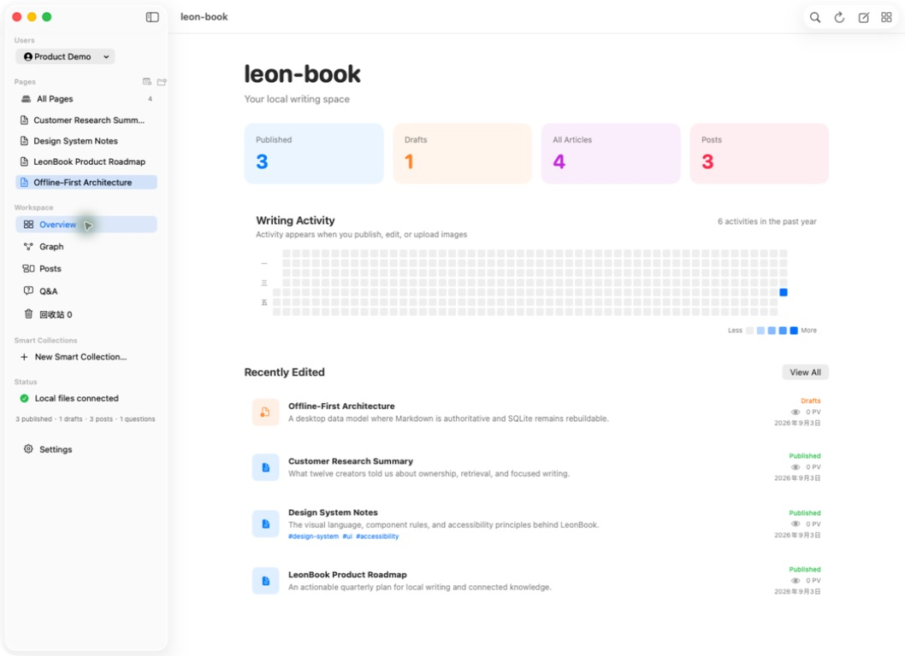
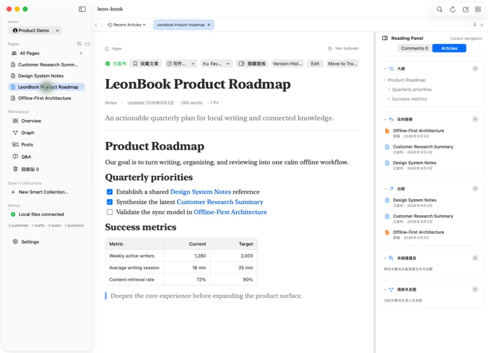
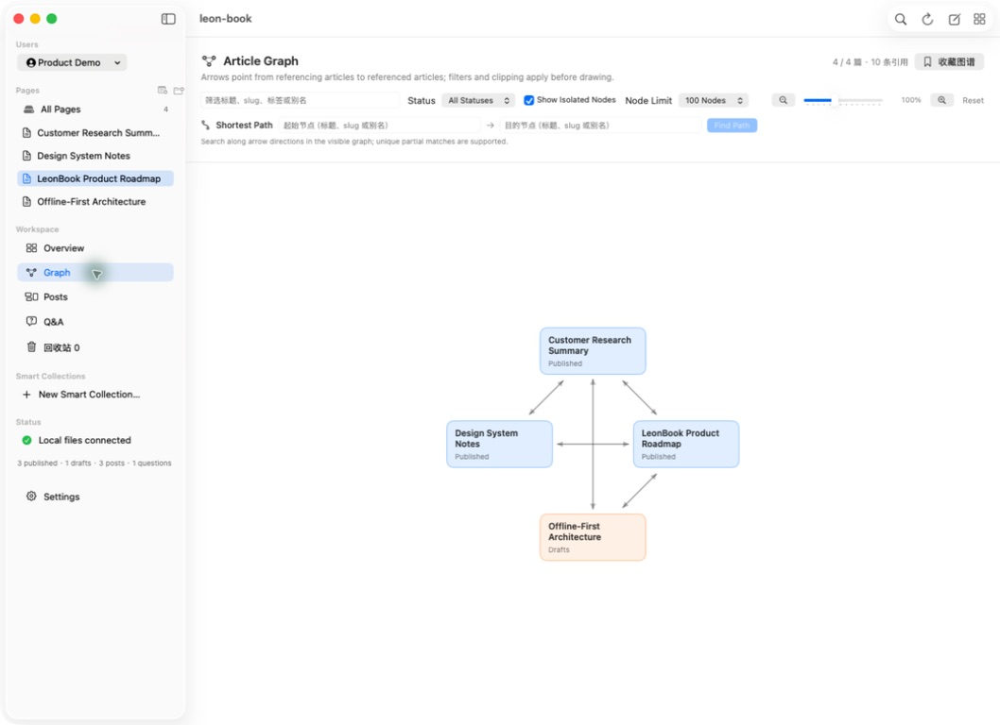
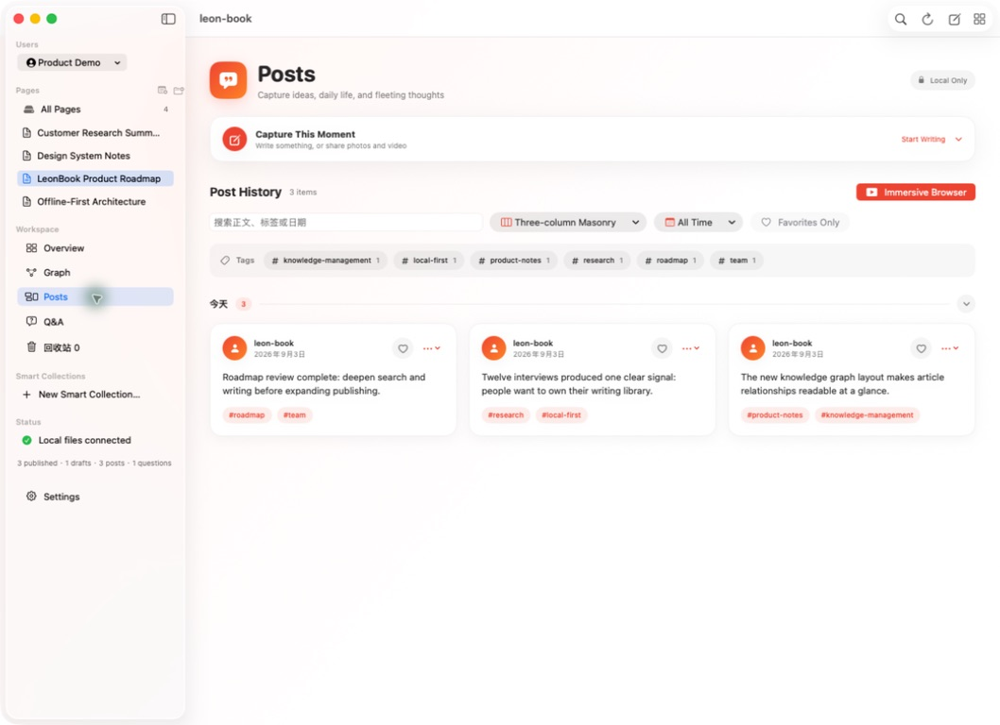
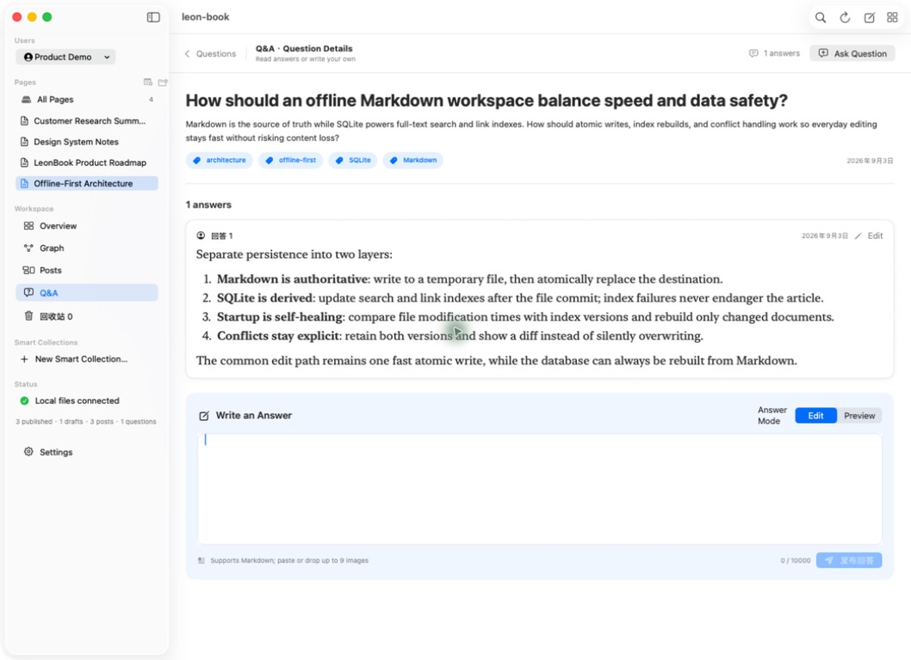

# leon-book

[English](README.md) | [简体中文](README.zh-CN.md)

A native macOS workspace for writing, collecting ideas, and organizing personal content. Keep articles, local posts, Q&A, tasks, photos, audio, and video together, with a homepage you can arrange around your work.

Built with **SwiftUI, AppKit, WebKit, and SQLite**. Core writing and library features work offline; the app runs without a Node.js service, an external browser, or a local HTTP server. Articles and media stay in your chosen data directory.

[Quick start](#quick-start) · [Features](#features) · [Data and backups](#data-and-backups) · [Automation](#automation) · [Development](#development)

## Quick start

Build requirements: **macOS 13+** and **Swift 5.10+** with a macOS SDK. Command Line Tools with a compatible toolchain are sufficient; full Xcode is optional.

From the repository root:

```bash
./scripts/leonblog open
```

The script builds the app if it is missing or out of date, then opens it. The first build uses Debug; subsequent launches reuse the installed build configuration. The app bundle is written to `macos/dist/leon-book.app` and is ad-hoc signed for local use.

To choose a data directory explicitly:

```bash
LEON_BOOK_WORKDIR="$HOME/Documents/LeonBookData" ./scripts/leonblog open
```

Without this override, the app uses your remembered directory, then the repository's default of `/Volumes/T7Shield/myblog`. If that directory does not exist, the app asks you to choose one. Each local user has an independent workspace.

## Features

| Area | What you can do |
| --- | --- |
| Custom homepage | Combine text, images, audio, video, articles, tasks, statistics, recent edits, and activity. Drag modules to reorder or resize them, then save your layout. |
| Writing | Edit HTML rich text with headings, lists, tables, code blocks, callouts, and attachments. Use `/` commands, save drafts, compare versions, and restore recovery snapshots. |
| Article library | Organize articles in directories up to five levels deep. Switch between list, table, card, board, and calendar views; use categories, tags, and typed properties. |
| Search and links | Search articles and posts with SQLite FTS5. Navigate outlines, backlinks, outgoing links, and knowledge graphs; keep articles, headings, and searches in bookmarks. |
| Whiteboards and canvas | Insert offline Excalidraw drawings into articles, or arrange articles, posts, notes, webpages, and files on an infinite canvas with groups and connections. Import and export `.canvas` files. |
| Posts and Q&A | Keep a local timeline with images, comments, and replies, and collect questions with their answers. |
| Photos | Create albums, import or drag in images from Finder, select multiple items, search and sort, and browse full-size images with zoom and keyboard navigation. |
| Media Library | Organize video and audio into independent groups, add introductions, search, and play files with native controls and saved progress. |
| Tasks | Track priorities, due dates, and notes. Filter open, today, overdue, and completed tasks, and include a task list on the homepage. |
| Workspaces | Switch between local users, keep navigation independent across windows, and save named reading or writing layouts. |

Article **Publish** and posting to the timeline update your local library. They do not publish content to an internet service. Embedded remote webpages require a network connection.

### Writing and navigation

Type `/` at the start of a paragraph for commands such as `/h1`, `/code`, `/callout`, `/task`, `/table`, and `/whiteboard`. Whiteboards are saved as editable scene files with article previews; double-click a preview to continue drawing.

Editing pauses trigger a recovery snapshot after 3 seconds. Version history supports comparison and restoration; **Save Draft** and **Publish** remain the explicit actions for saving article content.

| Shortcut | Action |
| --- | --- |
| `⌘O` | Quickly find and open an article |
| `⌘P` | Open the command palette |
| `⇧⌘F` | Open full-text search |

Commands support recent items, pins, and configurable shortcuts in **Settings → Commands and Shortcuts**. Search supports filters such as `tag:writing`, `status:draft`, `type:article`, and `[property:value]`.

## Screenshots

These repository screenshots use a separate demo workspace with sample content. They illustrate the writing, linking, and timeline views; layouts may differ from the current version.



<details>
<summary>Article reading, knowledge graph, posts, and Q&A</summary>









</details>

## App commands

Run these commands from the repository root:

| Command | Behavior |
| --- | --- |
| `./scripts/leonblog open` | Build if needed and open the app; `start` is an alias |
| `./scripts/leonblog restart` | Quit gracefully, build if needed, and relaunch with Debug by default |
| `./scripts/leonblog restart --release` | Restart with an optimized Release build |
| `./scripts/leonblog build` | Build and package Release without launching |
| `./scripts/leonblog test` | Run the native test and check suites |
| `./scripts/leonblog coverage` | Run unit tests and generate a coverage report |
| `./scripts/leonblog help` | Show command help |

`open`, `start`, `restart`, and `build` accept `--debug` or `--release`. Debug uses the native build engine when available, with a separate cache from normal Release builds; automatic selection falls back to the toolchain default when needed. Set `LEON_BOOK_BUILD_SYSTEM=default` to select the toolchain default explicitly. The first build for a configuration populates its cache.

## Data and backups

The app chooses its data root in this order:

1. `LEON_BOOK_WORKDIR`, when set.
2. The directory remembered from your previous selection.
3. `/Volumes/T7Shield/myblog`, the current repository default.

A typical data directory contains:

```text
data-root/
├── leon-book.sqlite          # Local users and active-user settings
├── users.json                # Compatibility export
├── active-user.json          # Compatibility export
└── workspaces/
    └── <user-id>/
        ├── leon-book.sqlite  # Content indexes and structured records
        ├── articles/         # HTML articles and compatibility files
        ├── drafts/           # Draft recovery copies
        ├── media/            # Images, audio, video, and whiteboard assets
        ├── canvases/         # Saved .canvas documents
        ├── moments/          # Post exports and feed index
        ├── activity/         # Creative activity records
        ├── trash/            # Trashed content
        └── extensions/       # Optional declarative extension packages
```

Current article editing saves **HTML rich text** as `.html` files. SQLite stores article indexes alongside comments, revision history, bookmarks, tasks, homepage layouts, albums, and media groups. Those structured records are part of your data: backing up only `articles/` does not preserve the complete workspace. Media remains in ordinary local files.

Older Markdown content retains a compatibility read and one-way conversion path. Markdown/Obsidian import and mount controls have been removed from the normal settings flow; an existing mounted workspace can switch back to the app-managed library from the article-format section in Settings. The automation API also accepts Markdown and converts it to HTML on input.

### Backups

Choose a separate destination in **Settings → Backups**. After data changes, the default policy creates at most one automatic snapshot per hour, retains snapshots for 90 days, caps the set at 60, and keeps at least 10 GB free. These limits are configurable, and you can also back up manually.

Snapshots include the data root and its user workspaces. Unchanged files use APFS clones when available, or reuse/copy from earlier snapshots. The app offers snapshot verification and whole-library restore, with a safety snapshot before restoration. The destination must be outside the live data directory; any legacy externally mounted article folders need separate backups. Backups are local, unencrypted files and are not uploaded automatically.

## Automation

The CLI exposes content operations for external tools and AI assistants through JSON commands and a JSON Lines interface:

```bash
./scripts/leonblog api capabilities
./scripts/leonblog api articles.list --json '{"limit":20}'
./scripts/leonblog api --stdio
```

When the app is running, the CLI uses its local Unix socket. When it is closed, the CLI uses the same storage layer directly. Use `--root` for the data root containing `workspaces/`, and `--user` to select a specific local user. First use may compile the CLI.

The app also supports `leonbook://new`, `leonbook://open?slug=example`, `leonbook://search?q=example`, and `leonbook://today`, with corresponding macOS Shortcuts/App Intents.

See the [AI automation guide](docs/AI_AUTOMATION.md) for method discovery, input formats, concurrency rules, and Python examples.

## Development

```text
scripts/leonblog                    # App and automation command entry point
macos/Package.swift                # SwiftPM products and targets
macos/Sources/LeonBookApp/          # App entry point and App Intents
macos/Sources/LeonBook/             # UI, editor, storage, and host adapters
macos/Sources/LeonBookCLI/          # JSON CLI and JSON Lines transport
macos/Sources/LeonBookModuleKit/    # First-party module contracts
macos/Sources/LeonBook*Module/      # Search, graph, publishing, backup, capture, tasks
macos/Sources/LeonBookExtensionKit/ # Declarative extension contracts
macos/Whiteboard/                   # Excalidraw resource build sources
macos/Tests/                       # Native, module, and automation tests
macos/Checks/                      # Additional application and storage checks
macos/scripts/                     # Build, test, coverage, and performance scripts
```

First-party modules can be enabled independently in Settings. Declarative extensions use a versioned `extension.json` to contribute commands, template variables, text/JSON importers, and fence renderers. See the [example extension](macos/Examples/DeclarativeExtension/extension.json).

Normal Swift builds use the bundled whiteboard assets and do not require Node.js. Node.js/npm are needed only when rebuilding those assets; follow the [whiteboard guide](macos/Whiteboard/README.md).

Further documentation: [macOS guide](macos/README.md) · [Performance notes](macos/PERFORMANCE.md) · [AI automation](docs/AI_AUTOMATION.md).
