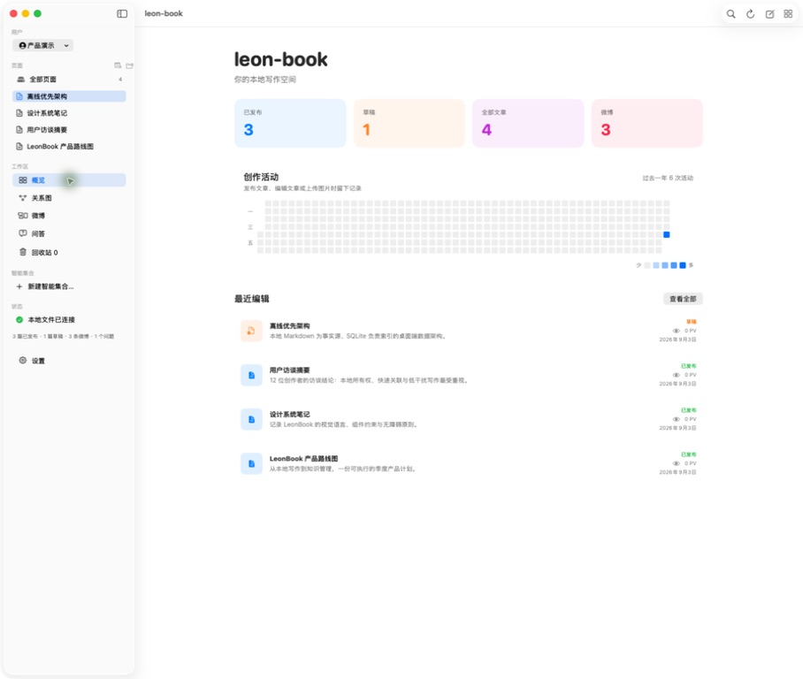
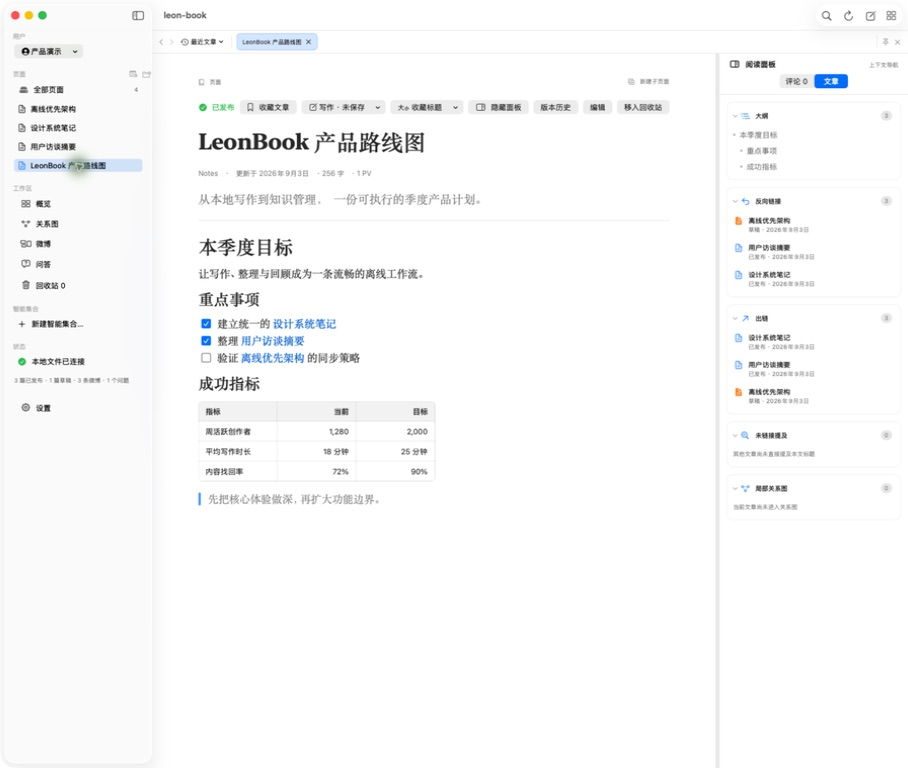
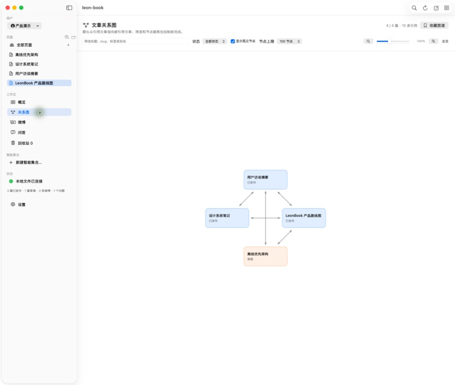
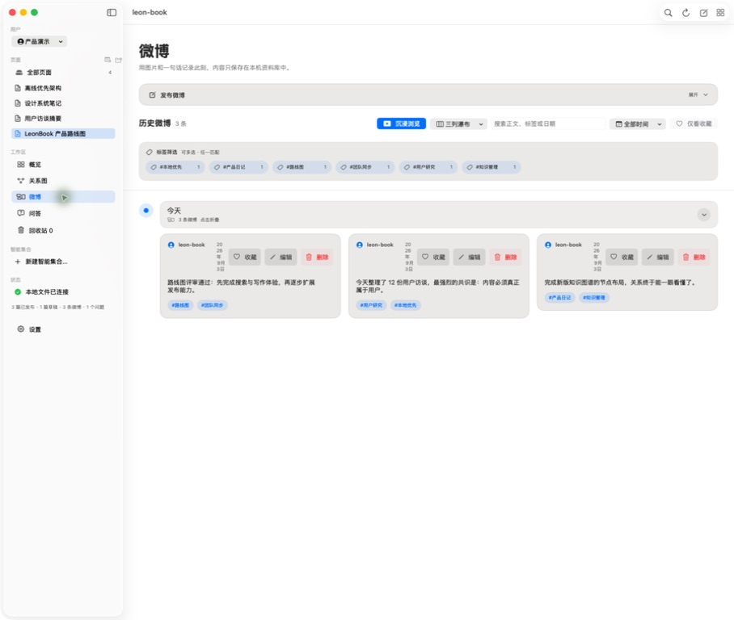
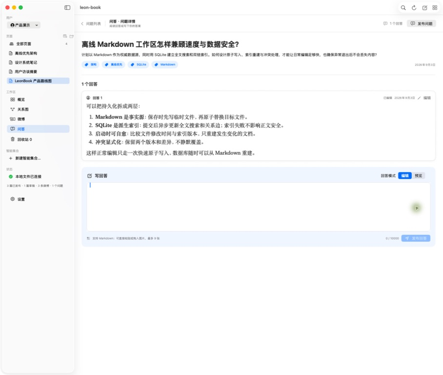

# leon-book

[English](README.md) | [简体中文](README.zh-CN.md)

一款用于写作、记录灵感和整理个人内容的原生 macOS 工作台。将文章、本地微博、问答、待办、图片和音视频放在同一个工作空间，并按自己的习惯布置首页。

应用基于 **SwiftUI、AppKit、WebKit 和 SQLite** 构建。核心写作与资料管理功能支持离线使用，运行时无需 Node.js 服务、外部浏览器或本地 HTTP 服务。文章和媒体保存在你选择的数据目录中。

[快速开始](#快速开始) · [主要功能](#主要功能) · [数据与备份](#数据与备份) · [自动化接入](#自动化接入) · [开发说明](#开发说明)

## 快速开始

构建要求：**macOS 13+**、**Swift 5.10+** 和 macOS SDK。提供相应工具链的 Command Line Tools 即可，无需安装完整 Xcode。

在项目根目录执行：

```bash
./scripts/leonblog open
```

脚本会在应用缺失或过期时先构建，再打开应用。首次构建使用 Debug，之后沿用已安装版本的构建模式。生成的应用位于 `macos/dist/leon-book.app`，使用适合本机运行的临时签名。

如需指定数据目录：

```bash
LEON_BOOK_WORKDIR="$HOME/Documents/LeonBookData" ./scripts/leonblog open
```

未指定时，应用优先使用上次记住的目录，再使用仓库当前默认路径 `/Volumes/T7Shield/myblog`。如果目录不存在，应用会提示选择。每个本地用户拥有独立的工作空间。

## 主要功能

| 功能 | 可以做什么 |
| --- | --- |
| 自定义首页 | 组合文字、图片、音频、视频、文章、待办、统计、最近编辑和创作活动；拖动模块排序、调整尺寸并保存布局。 |
| 文章写作 | 编辑 HTML 富文本，使用标题、列表、表格、代码框、高亮框和附件；通过 `/` 快捷插入，保存草稿、比较版本并恢复编辑快照。 |
| 文章资料库 | 使用最多五级目录组织文章，在列表、表格、卡片、看板和日历之间切换，配合分类、标签与类型化属性整理内容。 |
| 搜索与关联 | 使用 SQLite FTS5 搜索文章和微博，通过大纲、反向链接、出链和知识图谱浏览内容，收藏文章、标题与搜索条件。 |
| 画板与无限画布 | 在文章中插入离线 Excalidraw 画板；也可将文章、微博、便签、网页和文件放入无限画布，分组、连线，并导入导出 `.canvas`。 |
| 微博与问答 | 记录本地图文动态，添加评论和回复，整理问题及其回答。 |
| 图片与相册 | 创建相册，从 Finder 拖入或批量导入图片，多选、搜索与排序，并通过缩放和键盘切换浏览大图。 |
| 影音库 | 独立分组管理视频和音频，添加介绍、搜索内容，使用原生控件播放并记忆播放进度。 |
| 待办 | 设置优先级、截止日期和备注，按未完成、今天、逾期或已完成筛选，也可将待办清单放到首页。 |
| 工作空间 | 切换本地用户，在不同窗口中独立导航，并保存命名的阅读或写作布局。 |

文章“发布”和微博发布都作用于本地资料库，不会向互联网平台发送内容。内嵌远程网页需要网络连接。

### 写作与快捷操作

在段落开头输入 `/`，可使用 `/h1`、`/code`、`/callout`、`/task`、`/table`、`/whiteboard` 等命令。画板保存为可编辑的场景文件，并在文章中显示预览；双击预览可继续绘制。

停止输入 3 秒后会自动保存恢复快照，版本历史支持比较与恢复。“保存草稿”和“发布”仍是正式保存文章的操作。

| 快捷键 | 操作 |
| --- | --- |
| `⌘O` | 快速查找并打开文章 |
| `⌘P` | 打开命令面板 |
| `⇧⌘F` | 打开全文搜索 |

命令面板支持最近使用和固定命令，可在“设置 → 命令与快捷键”中调整快捷键。搜索支持 `tag:写作`、`status:draft`、`type:article`、`[属性名:值]` 等筛选条件。

## 软件截图

以下为仓库内的产品演示截图，使用独立工作区中的示例数据，展示写作、内容关联和时间线等界面；布局可能与当前版本不同。



<details>
<summary>查看文章阅读、知识图谱、微博和问答</summary>









</details>

## 应用管理命令

以下命令均在项目根目录执行：

| 命令 | 行为 |
| --- | --- |
| `./scripts/leonblog open` | 按需构建并打开应用；`start` 是它的别名 |
| `./scripts/leonblog restart` | 正常退出当前应用，按需构建并重启，默认使用 Debug |
| `./scripts/leonblog restart --release` | 使用优化后的 Release 构建重启 |
| `./scripts/leonblog build` | 构建并打包 Release，不启动应用 |
| `./scripts/leonblog test` | 运行原生测试与检查 |
| `./scripts/leonblog coverage` | 运行单元测试并生成覆盖率报告 |
| `./scripts/leonblog help` | 查看命令帮助 |

`open`、`start`、`restart`、`build` 均支持 `--debug` 和 `--release`。Debug 在可用时采用 native 构建引擎，缓存与常规 Release 构建分开；自动选择时若该引擎不可用，会回退到工具链默认引擎。可设置 `LEON_BOOK_BUILD_SYSTEM=default` 显式使用工具链默认引擎。每种构建配置首次使用时需要建立缓存。

## 数据与备份

应用按以下顺序选择数据根目录：

1. 环境变量 `LEON_BOOK_WORKDIR`。
2. 应用记住的上次选择目录。
3. 仓库当前默认路径 `/Volumes/T7Shield/myblog`。

典型的数据目录结构如下：

```text
data-root/
├── leon-book.sqlite          # 本地用户与当前用户设置
├── users.json                # 兼容性导出
├── active-user.json          # 兼容性导出
└── workspaces/
    └── <user-id>/
        ├── leon-book.sqlite  # 内容索引及结构化记录
        ├── articles/         # HTML 文章及兼容性文件
        ├── drafts/           # 草稿恢复副本
        ├── media/            # 图片、音频、视频与画板素材
        ├── canvases/         # 已保存的 .canvas 文档
        ├── moments/          # 微博导出及时间线索引
        ├── activity/         # 创作活动记录
        ├── trash/            # 回收站内容
        └── extensions/       # 可选的声明式扩展包
```

当前文章编辑使用 **HTML 富文本**，正式内容保存为 `.html` 文件。SQLite 保存文章索引，以及评论、版本历史、收藏、待办、首页布局、相册和影音分组等记录。这些结构化记录也是用户数据的一部分，只备份 `articles/` 无法保留完整工作空间。媒体仍以普通本地文件保存。

旧 Markdown 内容保留兼容读取和单向转换路径。Markdown/Obsidian 导入与挂载入口已退出常规设置流程；已有挂载工作区可通过“设置 → 文章格式 → 切回应用内资料库”返回。自动化 API 也可接收 Markdown，并在输入时转换为 HTML。

### 备份

在“设置 → 备份”中选择独立目录。发生数据变化后，默认最多每小时生成一个自动快照，保留 90 天、最多 60 个，并要求至少剩余 10 GB 可用空间。以上策略均可调整，也可手动备份。

快照包含数据根目录及其中的用户工作空间。未变化的文件优先使用 APFS 克隆，或复用、复制上一快照中的文件。应用提供快照校验与整个资料库恢复，恢复前会先创建安全快照。备份目录必须位于当前数据目录之外；旧工作区挂载的外部文章目录需单独备份。备份为本地未加密文件，不会自动上传。

## 自动化接入

CLI 通过 JSON 命令和 JSON Lines 接口向外部工具及 AI 助手提供内容操作能力：

```bash
./scripts/leonblog api capabilities
./scripts/leonblog api articles.list --json '{"limit":20}'
./scripts/leonblog api --stdio
```

应用运行时，CLI 连接其本地 Unix Socket；应用关闭时，直接使用同一套存储逻辑。`--root` 指向包含 `workspaces/` 的数据根目录，`--user` 可指定本地用户。首次调用可能需要编译 CLI。

应用还支持 `leonbook://new`、`leonbook://open?slug=example`、`leonbook://search?q=example`、`leonbook://today`，并提供对应的 macOS 快捷指令/App Intents。

方法发现、输入格式、并发规则与 Python 示例见 [AI 自动化接入](docs/AI_AUTOMATION.md)。

## 开发说明

```text
scripts/leonblog                    # 应用管理与自动化命令入口
macos/Package.swift                # SwiftPM 产品与 target 定义
macos/Sources/LeonBookApp/          # 应用入口与 App Intents
macos/Sources/LeonBook/             # 界面、编辑器、存储及宿主适配
macos/Sources/LeonBookCLI/          # JSON CLI 与 JSON Lines 通信
macos/Sources/LeonBookModuleKit/    # 第一方模块契约
macos/Sources/LeonBook*Module/      # 搜索、图谱、发布、备份、采集和待办
macos/Sources/LeonBookExtensionKit/ # 声明式扩展契约
macos/Whiteboard/                   # Excalidraw 资源构建源码
macos/Tests/                       # 原生、模块与自动化测试
macos/Checks/                      # 应用及存储专项检查
macos/scripts/                     # 构建、测试、覆盖率与性能脚本
```

第一方模块可在设置中独立启停。声明式扩展通过版本化的 `extension.json` 提供命令、模板变量、文本/JSON 导入器和围栏渲染器，格式见 [扩展示例](macos/Examples/DeclarativeExtension/extension.json)。

常规 Swift 构建直接使用仓库内的画板资源，无需 Node.js；仅在重新构建这些资源时需要 Node.js/npm，操作见 [画板开发说明](macos/Whiteboard/README.md)。

进一步阅读：[macOS 开发与使用说明](macos/README.zh-CN.md) · [性能说明](macos/PERFORMANCE.md) · [AI 自动化接入](docs/AI_AUTOMATION.md)。
