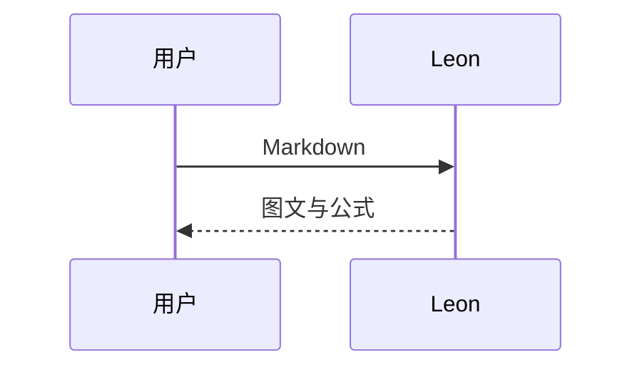

# 扩展 Markdown

## 任务与提示

- [x] Mac 和 Android 共用排版
- [ ] 待办复选框

> [!TIP]
> 支持 **粗体**、==高亮==、H~2~O、x^2^ 和 :smile:。

术语
: 定义列表可以包含 **格式**。

正文中的脚注[^note]，以及 [[任务与提示|返回任务标题]]。

<details><summary>展开详细说明</summary>

折叠正文保留 Markdown 段落和 **粗体**。

</details>

## 代码与公式

```javascript
const result = "保留原文";
console.log(result);
```

行内 \(\frac{a}{b}\) 与 $x_i^2$。

\[
\text{Attention}(Q,K,V)=\text{softmax}\left(\frac{QK^T}{\sqrt{d_k}}\right)V
\]

## 合并单元格

<table>
<tr><th colspan="2">合并标题</th></tr>
<tr><td rowspan="2">类别</td><td>第一项</td></tr>
<tr><td>第二项</td></tr>
</table>

## 图表




[^note]: 脚注包含 **说明文字** 和返回链接。
